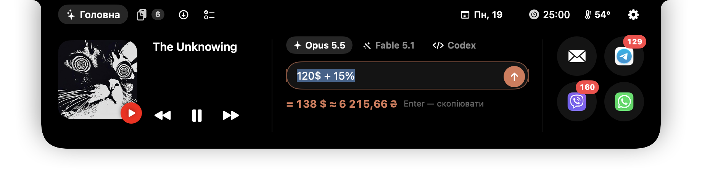
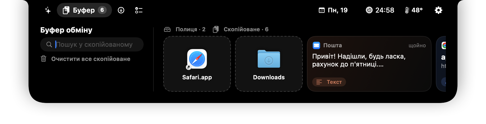
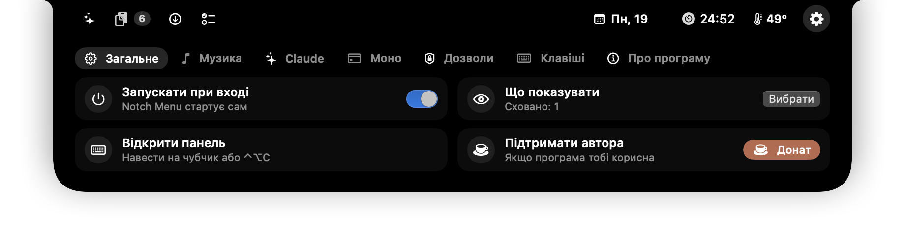

# Notch Menu

**Корисна панель під «чубчиком» MacBook.** Наведи курсор на чубчик (або натисни **⌃⌥C**), і з-під нього плавно виїде чорна панель: музика, питання до Claude, Codex чи Gemini, буфер обміну, завантаження, монобанк, нагадування, календар і температура Mac.



| Буфер | Налаштування |
|---|---|
|  |  |

> 🇬🇧 English summary is [below](#english).

## Що вміє

- **Головна.** «Зараз грає» з **Apple Music** або **YouTube Music** (у Chrome) з кнопками ⏮ ⏯ ⏭. Питання до **Claude Opus / Fable** через твою підписку Claude (застосунок Claude desktop) до **Codex** через підписку ChatGPT або до **Gemini** безкоштовно (Gemini CLI з входом через Google або безкоштовний ключ з [AI Studio](https://aistudio.google.com/apikey)). Калькулятор прямо в полі: «120$ + 15%» одразу покаже суму в гривнях. Круглі кнопки Gmail, Telegram, Viber, WhatsApp із лічильниками пропущених.
- **Буфер.** Усе текстове, що ти копіював за останню годину, лише в пам'яті. На кожній картці кнопки: «Скопіювати», «Розкладка» (ghbdsn → привіт), «Перекласти / Переписати / Пояснити» з Claude, а також «розумні» кнопки: подзвонити, відкрити в Картах, відстежити ТТН Нової пошти, IBAN без пробілів. Файл, перетягнутий на чубчик, лягає на полицю; з фото й скріншотів програма розпізнає текст.
- **Викачане.** Останні файли з «Завантажень»: відкрити, показати у Finder, перетягнути куди треба.
- **Моно** (лише перегляд). Картки, баланс, банки з прогресом, операції, курс валют і бюджет на день.
- **Мої нагадування** та **шаблони** повідомлень.
- **Біля чубчика.** Найближча подія з Календаря, таймер Pomodoro, «Не засинати», температура процесора → екран «Система»: навантаження, пам'ять (і які програми її займають), батарея. Якщо Mac перегрівся або батарея сідає, біля чубчика з'явиться червона «пігулка».
- **Налаштування.** Автозапуск, що показувати, комбінації клавіш, пауза музики під час дзвінка.

## Встановлення

1. Завантаж `NotchMenu.zip` з [Releases](../../releases), розпакуй і перетягни **Notch Menu** у «Програми».
2. Запусти. Програма підписана й перевірена Apple, тож відкривається звичайним подвійним кліком.
3. Наведи курсор на чубчик або натисни **⌃⌥C**.

**Потрібно:** MacBook з Apple Silicon (M1 і новіші), macOS 14 або новіша. Інтерфейс українською.

### Дозволи (macOS спитає сама, усе за бажанням)

| Дозвіл | Навіщо |
|---|---|
| Універсальний доступ | лічильники пропущених із Dock, кнопки YouTube Music, ⌃⌥L «Розкладка» |
| Керування «Музикою» / Chrome | трек, обкладинка й кнопки Apple Music, назва треку YouTube Music |
| Календар | найближча подія й тиждень (лише читання) |
| Папка «Завантаження» | вкладка «Викачане» (лише перегляд) |

## Приватність

- **Жодної телеметрії.** Програма нічого не збирає й нікуди не надсилає без твоєї дії.
- **Буфер обміну** зберігається лише в пам'яті й зникає через 60 хвилин. Паролі з менеджерів паролів, приховані типи буфера й рядки, схожі на ключі чи токени, туди не потрапляють.
- **Ключі й токени** (Claude API, Gemini, монобанк) лежать лише в «Зв'язці ключів» macOS.
- **Мережа:** `api.monobank.ua` (якщо підключиш монобанк), `api.anthropic.com` (лише якщо сам увімкнеш ключ API), `generativelanguage.googleapis.com` (якщо питаєш Gemini через ключ), обкладинки YouTube (`i.ytimg.com`) і пошук обкладинок у каталозі iTunes (`itunes.apple.com`). Claude Code, Codex і Gemini CLI, які запускаються локально, звертаються до своїх серверів, коли ти ставиш їм питання. Посилання (Карти, Нова пошта, Gmail) відкриваються лише після твого кліку.
- **Gemini безкоштовно:** на безкоштовному рівні Google може використовувати питання для покращення своїх моделей. Не надсилай туди нічого приватного.
- **Нагадування й шаблони** зберігаються у файлі на твоєму Mac: `~/Library/Application Support/NotchMenu/`.

## ☕ Підтримати автора

Програма безкоштовна. Якщо вона тобі знадобилась, можна закинути на каву в **[банку монобанку](https://send.monobank.ua/jar/9rEAGpeFqv)**: вона приймає будь-які картки, Apple Pay і Google Pay. Кнопка «Донат» є і в налаштуваннях програми.

## Зібрати самому

Потрібні Command Line Tools від Apple (Xcode не потрібен):

```bash
scripts/build.sh test      # тести логіки
scripts/build.sh install   # зібрати й поставити в ~/Applications
scripts/build.sh release   # підпис Developer ID + перевірка Apple → dist/NotchMenu.zip
```

Скрипт збирає програму компілятором `swiftc` і сам підбирає сумісний SDK (на деяких версіях Command Line Tools `swift build` не працює). Підпис вибирається автоматично: Developer ID, власний сертифікат «Notch Menu Signing» або «домашній». Явно задати його можна так: `SIGN_IDENTITY="…" scripts/build.sh app`.

---

## English

**Notch Menu** is a free, open-source panel that slides out from under the MacBook notch (hover the notch or press **⌃⌥C**): now playing (Apple Music / YouTube Music in Chrome), ask Claude (via your own Claude subscription through the Claude desktop app) Codex (via your ChatGPT subscription) or Gemini (free, via Gemini CLI or a free AI Studio key), a 60-minute in-memory clipboard history with smart actions and OCR, recent Downloads, read-only monobank (Ukrainian bank) balance, notes and message templates, calendar, a Pomodoro timer, keep-awake, CPU temperature and memory usage. The UI is in Ukrainian.

- Requires Apple Silicon and macOS 14+. Signed with Developer ID and notarized by Apple.
- Privacy: no telemetry; clipboard is kept in memory only (never passwords or secrets); keys live in the macOS Keychain.
- Build: `scripts/build.sh install` (Command Line Tools only).

The design is inspired by the notch-panel style popularized by apps like NotchNook. This project is independent and is **not affiliated** with NotchNook/lo.cafe, Anthropic, OpenAI, Apple, Google, or monobank. It uses your own subscriptions, accounts and tokens.

License: [MIT](LICENSE). Donations: [monobank jar](https://send.monobank.ua/jar/9rEAGpeFqv).
